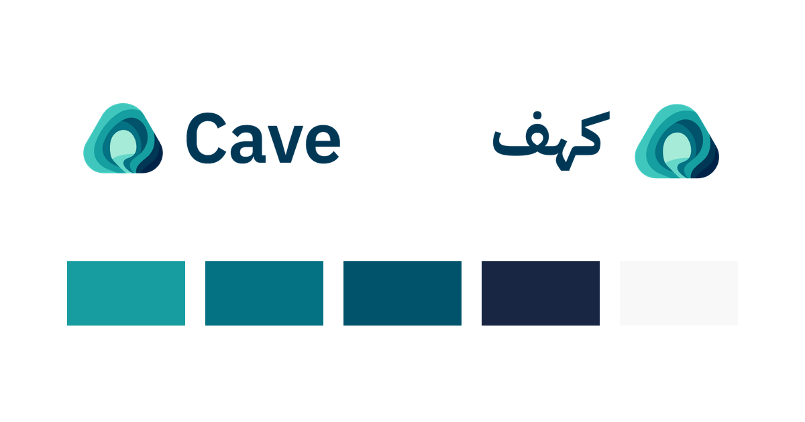

<p align="center"></p>
<h1 align="center">Cave Brand · كهف</h1>
<p align="center"><strong>The official Cave identity, in English and Arabic.</strong><br>IBM Plex · R3 · Beta</p>
<p align="center"><a href="https://brand.cave.technology">Live guide</a> · <a href="kit/cave-brand-kit.zip">Download kit</a> · <a href="CONTRIBUTING.md">Contribute</a> · <a href="CHANGELOG.md">Changelog</a></p>

Approved logos, original symbol, colours, patterns and icons, with bilingual usage rules and self-hosted typography. This is a static HTML/CSS/JavaScript site: **no runtime dependencies, build service, analytics or paid tooling**.



**Repository status:** Plex R3 beta candidate. A commit on `main` does not establish what is live. Deployment and publication of a GitHub prerelease are separate owner-reviewed steps. See the [release checklist](docs/releasing.md).

## Use the identity

- English: **Cave**. Arabic: **كهف**. Use the supplied language-specific logo, preserving its proportions.
- English typography: **IBM Plex Sans** — body 400, labels 500, headings and wordmark 600.
- Arabic typography: **IBM Plex Sans Arabic** — body 400, labels 500, headings and wordmark 700. Preserve connected shaping and normal letter spacing.
- The R3 Arabic wordmark has approximately 10% greater measured ink height, optically aligned with the English mark. Use the approved artwork; do not apply that ratio to body text.
- Full colour logos belong on white or paper; white logos belong on teal, navy or charcoal. The original symbol, colours, icons, patterns and wallpapers retain their approved artwork.

The kit includes R3 logo masters, matching font-independent web outlines, icons, patterns, font originals and notices. The website offers SVG downloads, transparent PNG export, permitted background previews and colour copying. Desktop wallpapers are separate original 1916 × 821 downloads. [Sources and provenance](docs/brand-sources.md).

## Run locally

From the repository root:

```sh
python3 -m http.server 8080 --bind 127.0.0.1
```

Open English at `http://127.0.0.1:8080/` and Arabic at `http://127.0.0.1:8080/ar/`. Firebase uses the clean production URL `/ar`. Appearance options are System, Light, Dark and Black; the saved choice is shared across languages and tabs.

## Check a change

```sh
python3 scripts/check.py
python3 scripts/build-kit.py --check
node --check assets/js/theme.js
node --check assets/js/brand-tools.js
```

Checks use only Python and Node standard libraries. Review both languages at 320 px, 390 px and desktop widths, in all four appearances. Verify real font loading, shaping, image rendering, keyboard focus, background choices, colour copying, SVG/PNG downloads and the kit contents. The optional browser matrix uses an existing Playwright installation: `PLAYWRIGHT_MODULE=/path/to/playwright node scripts/browser-review.cjs` (Chrome path and preview URL are configurable in the script). Use `BRAND_BROWSER=firefox` or `BRAND_BROWSER=webkit` to select another installed engine. Run `scripts/accessibility-review.cjs` with the same Playwright path and `AXE_SCRIPT=/path/to/axe.min.js` for the optional axe/keyboard matrix. Local checks are documented in [validation](docs/validation.md); they do not claim a production deployment or complete accessibility certification.

CI remains disabled. No Actions workflow, automatic deployment or paid service is introduced. The optional design-system copy check needs a separate checkout: `CAVE_DESIGN_DIR=/path/to/design node scripts/sync-from-design.mjs --check`. Brand typography is an intentional local override in `brand.css`; generated design tokens remain unchanged.

## Repository map

| Path | Purpose |
| --- | --- |
| `index.html`, `ar/index.html`, `404.html` | English, RTL Arabic and not-found pages |
| `assets/css/` | Self-hosted font definitions, copied design tokens/components, brand overrides |
| `assets/logos/`, `assets/icons/`, `assets/patterns/` | Approved original masters at established URLs; `web/` contains font-independent delivery outlines |
| `assets/fonts/` | Compact Plex-derived web faces, source mapping and OFL notices |
| `vendor/ibm-plex/`, `vendor/brand-r3/` | Approved IBM font originals/notices and R3 vector PDF sources |
| `assets/wallpapers/` | Original Cave Horizon and Cave Flow PNGs |
| `kit/` | Reproducible downloadable kit and SHA-256 checksum |
| `scripts/`, `docs/`, `.github/` | Local checks, release guidance and issue/PR templates |

## Usage and licensing

**Cave marks and brand assets are proprietary, not open source.** The existing [brand licence](LICENSE.txt) permits unmodified files to refer to Cave in press, partner/integration pages and a “Powered by Cave” credit. Other uses need written permission from `info@cave.technology`. Do not redraw, recolour, retype or stretch the logos, or imply endorsement. Publishing this repository does not grant an open-source software licence.

IBM Plex fonts retain their SIL Open Font License 1.1, with copyright and notices bundled. Modified web subsets use the internal family names **Cave UI Latin / Cave UI Arabic** to respect the reserved font name; their designs come from IBM Plex. Original TTFs retain their original names. Hero and Blue Ocean are not distributed; they are not requested by the updated site. The separate design system's licence does not cover Cave marks.

## Maintaining and releasing

[Contributing](CONTRIBUTING.md) · [Changelog](CHANGELOG.md) · [Release checklist](docs/releasing.md) · [Brand provenance](docs/brand-sources.md)

Hosting is the existing Firebase project/site `cave-brand-kit`, with custom domain `brand.cave.technology`. Existing security headers are preserved. Do not deploy vendor sources, scripts, documentation, repository metadata, local evidence or proprietary font files. This project has no automatic release/deployment pipeline. Retired Poppins/Almarai font files remain in source history/compatibility files and are excluded from the new Hosting bundle.

After committing the reviewed source, `python3 scripts/prepare-release.py` creates an ignored `.local/releases/` handoff: a static Hosting ZIP, per-file hashes, exact target/scope, kit/checksums and beta release notes. This command never deploys, tags or publishes.

The owner will transfer the repository to the organization separately. After that transfer, update the canonical repository links, clone remote and issue/release references, and verify the existing custom domain and hosting before any subsequent release. Do not transfer Firebase ownership or change access as part of a repository content update.

[Cave](https://cave.technology) · [Design system](https://design.cave.technology) · [Cave Shops](https://shops.cave.technology)
